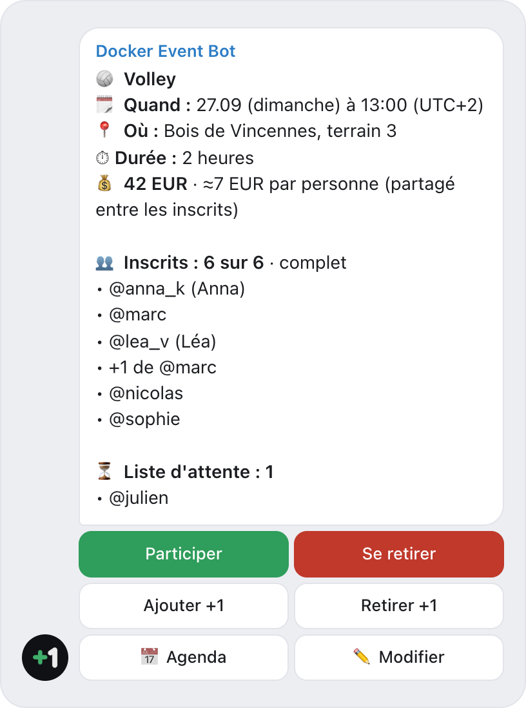
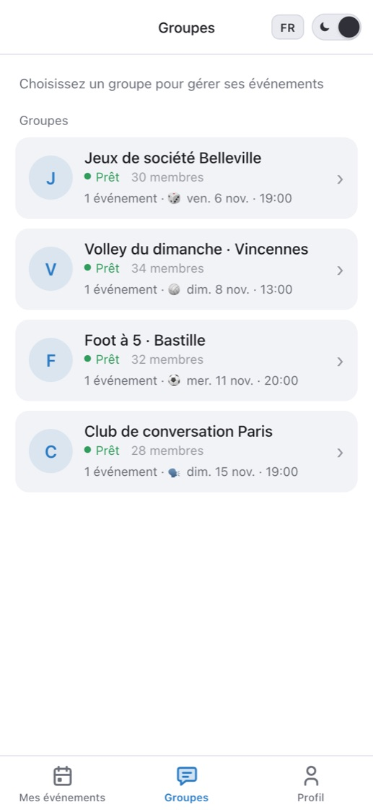
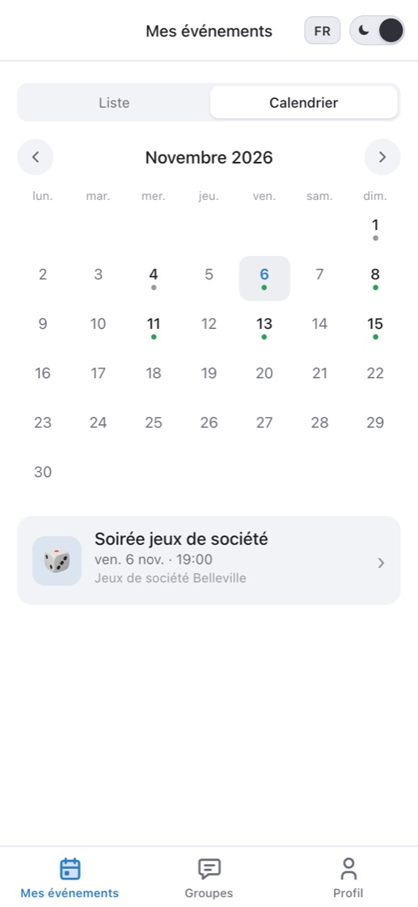
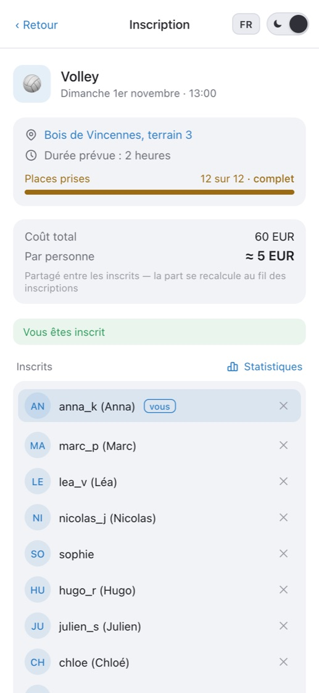
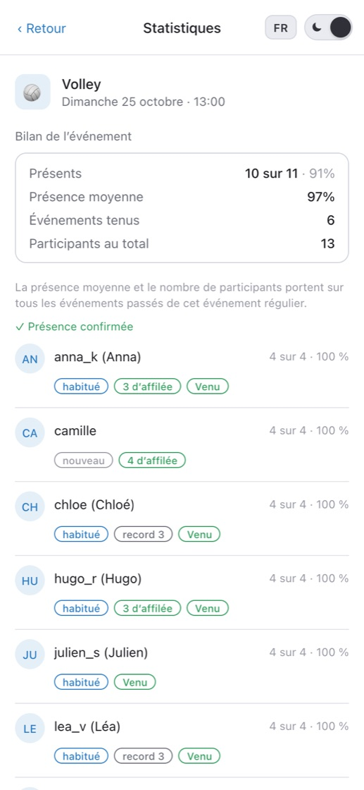
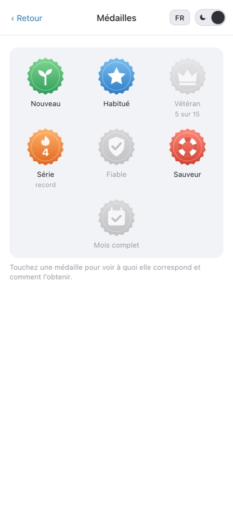

  

<h1 align="center">Docker Event Bot</h1>

  <b>Bot Telegram gratuit pour les inscriptions aux événements dans les groupes.</b> 
  Des fiches d’événement avec bouton, une limite de places, une liste d’attente automatique, des rappels et des événements réguliers — directement dans le groupe que vous utilisez déjà.

  <a href="https://t.me/DockerEventBot?startgroup=true"><b>Ajouter à un groupe</b></a> ·
  <a href="https://t.me/DockerEventBot">Ouvrir le bot</a> ·
  <a href="https://dockerbot.app/fr/">Site</a> ·
  <a href="https://www.youtube.com/watch?v=FidE_xEEUqA">Vidéo en anglais (1:17)</a>

  <a href="README.md">English</a> · <a href="README.ru.md">Русский</a> · <a href="README.sr.md">Srpski</a> · <b>Français</b>

> **Ce n’est pas Docker.** Docker Event Bot est un bot Telegram pour les inscriptions aux événements de groupe. Il n’a aucun lien avec les conteneurs Docker ni avec Docker, Inc.

  <picture>
    <source media="(prefers-color-scheme: dark)" srcset="screenshots/card-fr-dark.png">
    
  </picture>

## Pourquoi

Les applis d’événements échouent pour une seule raison : les douze personnes doivent en télécharger une, s’inscrire et la comprendre. Alors les groupes restent aux « +1 en commentaire » et aux sondages qui ne savent pas compter les places.

Docker Event Bot ne demande à personne de changer d’outil. Le bot publie une fiche d’événement dans votre groupe, chacun appuie sur **Participer**, et la liste, les places libres et la liste d’attente se mettent à jour d’elles-mêmes dans la fiche. Les membres n’ont besoin que de Telegram — pas d’appli, pas de compte, pas de formulaire.

## Fonctions

- ⏳ **Liste d’attente automatique** — plus de places, on passe en liste d’attente ; quelqu’un se retire, la personne suivante obtient la place et un message privé.
- ⏰ **Rappels** — jusqu’à trois (par exemple la veille et une heure avant) en message privé, plus un bouton « rappeler maintenant » pour l’organisateur. La veille, l’organisateur est prévenu s’il manque du monde pour atteindre le minimum.
- 🔁 **Événements réguliers** — « chaque mercredi à 20:00 » : le bot publie lui-même la nouvelle fiche à l’heure prévue. Les événements ponctuels marchent aussi.
- 👥 **Venir avec un ami** — « Ajouter +1 » : un ami sans Telegram prend une place et compte dans la limite.
- 📅 **Calendrier** — ajoutez l’événement à Google Agenda ou au Calendrier Apple (.ics) directement depuis la fiche.
- ✅ **Présence et fiabilité** — sondage « Vous y étiez ? » après l’événement et marques des admins ; les organisateurs voient qui s’est désisté à la dernière minute. Des médailles pour la présence et des séries pour chaque événement.
- 💰 **Partage des frais (facultatif)** — indiquez la location du terrain, la fiche affiche la part par personne et la recalcule au fil des inscriptions. L’argent ne passe pas par le bot.
- ⏱️ **Durée selon le nombre (facultatif)** — plus de monde, partie plus longue : « à partir de 6 personnes — une heure, à partir de 10 — une heure et demie ». La fiche met la durée à jour au fil des inscriptions.
- 🔔 **Annulations, reports, modifications** — chaque inscrit reçoit un message privé indiquant ce qui était prévu et ce qui l’est maintenant.
- 🏆 **Inscription par équipes (facultatif)** — on crée une équipe ou on en rejoint une ; la fiche affiche un tableau des compositions avec le capitaine indiqué. Pratique pour recueillir les inscriptions à un tournoi — le bot ne gère ni le tableau ni les scores.
- 📍 **Lien vers le lieu** — une carte ou un lien vers le lieu dans la fiche, les rappels et le calendrier.
- 💬 **Tous vos groupes au même endroit** — la Mini App dans Telegram montre tous les groupes avec le bot, toutes vos inscriptions dans un seul calendrier et un seul tableau de bord pour les organisateurs.
- 🌍 **Anglais, russe, serbe et français.**

## Comment ça marche

1. **Ajoutez [@DockerEventBot](https://t.me/DockerEventBot?startgroup=true) à votre groupe** et nommez-le admin — il en a besoin pour publier et épingler les fiches.
2. **Créez un événement** dans l’appli — ou envoyez `/start` dans le groupe et le bot propose le formulaire. Ponctuel ou hebdomadaire : lieu, heure et, si vous voulez, une limite de places.
3. **Chacun appuie sur « Participer ».** La liste, les places libres et la liste d’attente se mettent à jour directement dans la fiche.

## L’appli dans Telegram

<table>
  <tr>
    <td align="center" width="20%">
      <picture>
        <source media="(prefers-color-scheme: dark)" srcset="screenshots/chats-fr-dark.jpg">
        
      </picture>
       <b>Tous les groupes sur un écran</b>
    </td>
    <td align="center" width="20%">
      <picture>
        <source media="(prefers-color-scheme: dark)" srcset="screenshots/calendar-fr-dark.jpg">
        
      </picture>
       <b>Un calendrier pour toutes les inscriptions</b>
    </td>
    <td align="center" width="20%">
      <picture>
        <source media="(prefers-color-scheme: dark)" srcset="screenshots/event-fr-dark.jpg">
        
      </picture>
       <b>Page d’événement</b>
    </td>
    <td align="center" width="20%">
      <picture>
        <source media="(prefers-color-scheme: dark)" srcset="screenshots/stats-fr-dark.jpg">
        
      </picture>
       <b>Présence et fiabilité</b>
    </td>
    <td align="center" width="20%">
      <picture>
        <source media="(prefers-color-scheme: dark)" srcset="screenshots/medals-fr-dark.jpg">
        
      </picture>
       <b>Médailles pour la présence</b>
    </td>
  </tr>
</table>

## Pour

⚽ Foot · 🏐 Volley · 🎾 Tennis et padel · 🏀 Basket · 🧘 Yoga et sport · 🏃 Clubs de course · 🎲 Jeux de société · 🗣 Clubs de langues · 📚 Clubs de lecture · 🎤 Rencontres et ateliers · 🥾 Randonnées · 🎉 Fêtes et soirées

## Questions

**Dois-je héberger ou installer le bot moi-même ?**
Non. Docker Event Bot est un bot hébergé, prêt à l’emploi : ajoutez [@DockerEventBot](https://t.me/DockerEventBot) à votre groupe et publiez le premier événement. Rien à déployer, aucun serveur à faire tourner.

**C’est gratuit ?**
Oui. Pas d’abonnement ni de paiement via le bot. Le partage des frais facultatif calcule seulement la part de chacun — l’argent se règle entre vous, comme avant.

**Les participants doivent-ils installer quelque chose ?**
Non. Chacun s’inscrit avec un bouton sur la fiche dans le groupe. La Mini App s’ouvre dans Telegram quand vous avez besoin de plus.

**En quoi est-ce mieux qu’un sondage dans le groupe ?**
Un sondage Telegram ne sait ni limiter le nombre de places, ni tenir une liste d’attente, ni rappeler quoi que ce soit. La fiche du bot compte les places et fait avancer la liste d’attente quand quelqu’un se retire — dans le même groupe, et le bot rappelle chacun en privé avant le début.

**Qui peut créer et modifier les événements ?**
Seulement les admins du groupe. Chaque action est vérifiée sur le serveur.

**Quelles données le bot conserve-t-il ?**
Seulement ce dont les inscriptions ont besoin : identifiant Telegram, nom ou @pseudo, langue et historique des inscriptions. Envoyez `/privacy` au bot pour supprimer vous-même toutes vos données, tout de suite. Détails : [politique de confidentialité](https://dockerbot.app/fr/privacy/) · [conditions d’utilisation](https://dockerbot.app/fr/terms/).

## Générateur d’équipes gratuit

Besoin de répartir les inscrits en équipes ? Le [générateur d’équipes](https://dockerbot.app/fr/team-generator/) le fait au hasard ou de façon équilibrée selon le niveau (1–5). Il tourne dans votre navigateur ; la liste n’est envoyée nulle part.

## À propos de ce dépôt

C’est la vitrine publique de Docker Event Bot : description, captures d’écran et un endroit pour les questions et les idées. Le code source du bot n’est pas publié ici — et vous n’en avez pas besoin : le bot tourne déjà, ajoutez simplement [@DockerEventBot](https://t.me/DockerEventBot) à votre groupe.

Un bug ou une idée ? [Ouvrez une issue](../../issues) ou écrivez à **dockereventbot@gmail.com**. Vous pouvez aussi noter le bot directement dans l’appli, onglet Profil.
