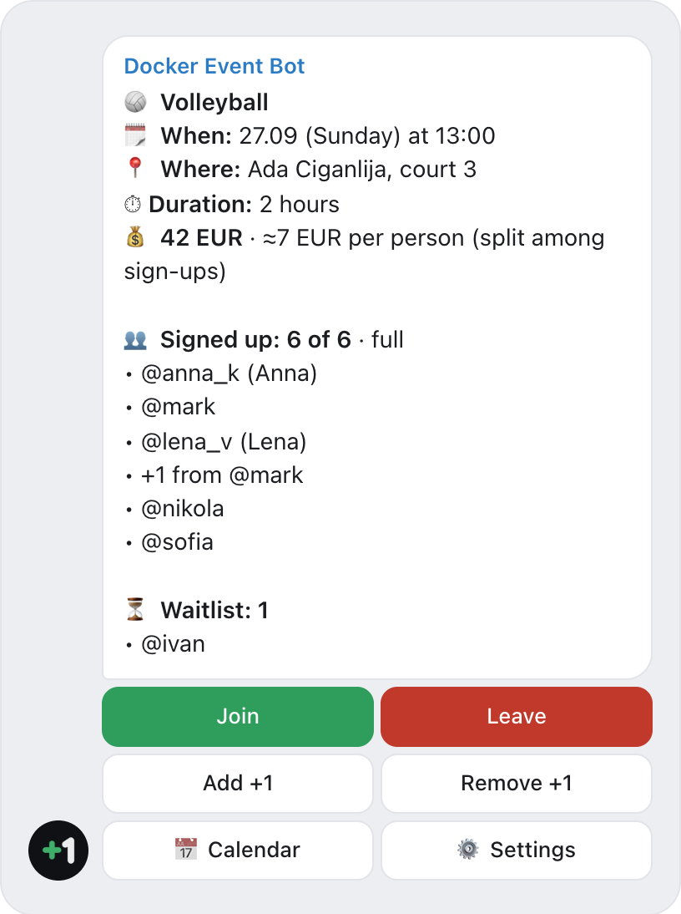
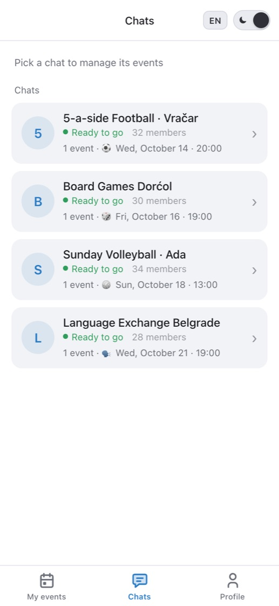
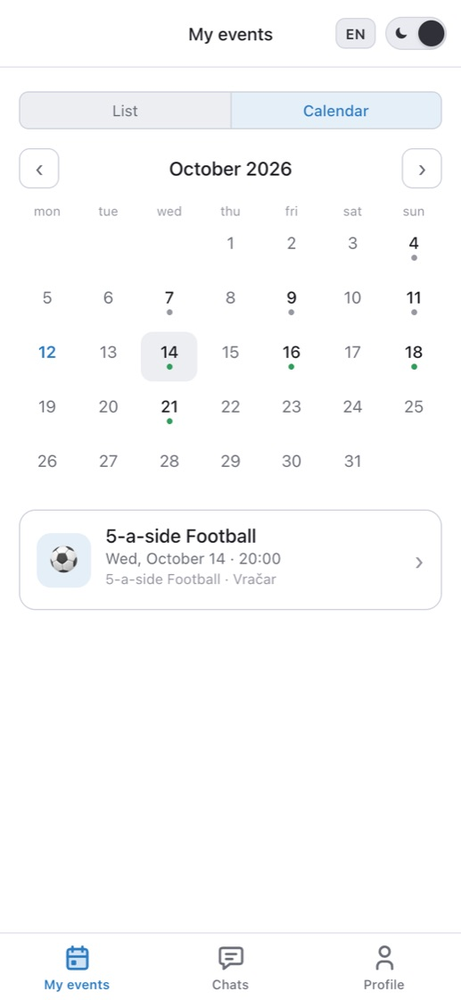
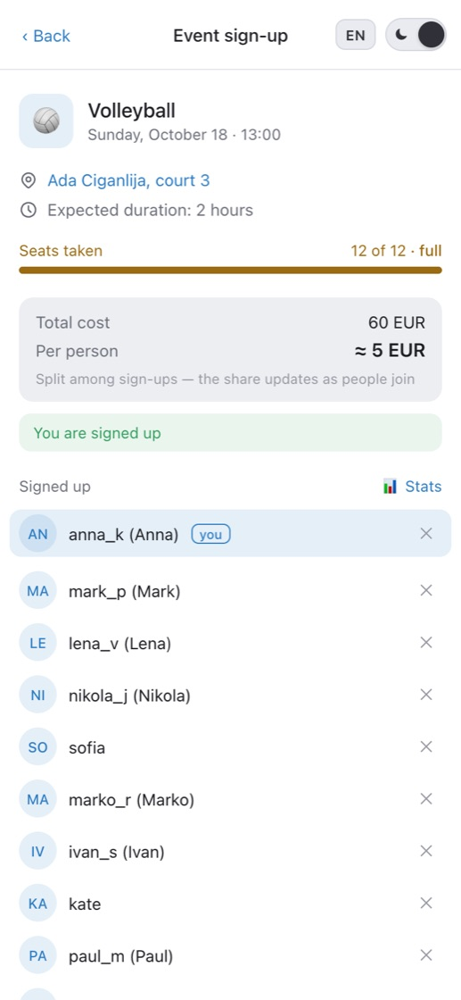
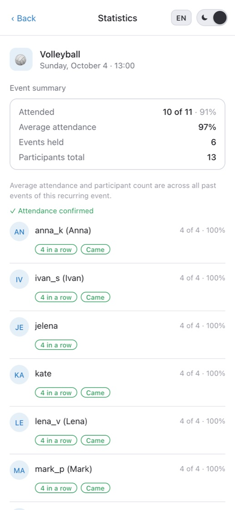

  

<h1 align="center">Docker Event Bot</h1>

  <b>Free Telegram bot for event sign-ups in group chats.</b> 
  Tap-to-join event cards, seat limits, a waitlist with auto-promotion, reminders and recurring events — right in the chat you already use.

  <a href="https://t.me/DockerEventBot?startgroup=true"><b>Add to a group</b></a> ·
  <a href="https://t.me/DockerEventBot">Open the bot</a> ·
  <a href="https://dockerbot.app/">Website</a> ·
  <a href="https://www.youtube.com/watch?v=AMKVzepg-64">Video (1:25)</a>

  <b>English</b> · <a href="README.ru.md">Русский</a> · <a href="README.sr.md">Srpski</a>

> **Not Docker.** Docker Event Bot is a Telegram bot for group event sign-ups. It is not related to Docker containers or Docker, Inc.

  <picture>
    <source media="(prefers-color-scheme: dark)" srcset="screenshots/card-en-dark.png">
    
  </picture>

## Why

Event apps lose for one reason: all twelve people have to download one, sign up and figure it out. So groups stay with “+1 in the comments” and polls that can’t count seats.

Docker Event Bot doesn’t ask anyone to move. The bot posts an event card in your group, people tap **Join**, and the list, free seats and the waitlist update in the card by themselves. Members need nothing but Telegram — no app, no account, no forms.

## Features

- ⏳ **Waitlist with auto-promotion** — out of seats, people join the waitlist; someone leaves, the next person gets the seat and a personal message.
- ⏰ **Reminders** — up to three (say, a day and an hour before) in private messages, plus a “remind now” button for the organizer. A day before, the organizer is told if the event is short of its minimum.
- 🔁 **Recurring events** — “every Wednesday at 20:00”: the bot posts the new card on schedule by itself. One-off events work too.
- 👥 **Bring a friend** — “Add +1”: a friend without Telegram takes a seat and is counted in the limit.
- 📅 **Calendar** — add the event to Google Calendar or Apple Calendar (.ics) straight from the card.
- ✅ **Attendance and reliability** — “Were you there?” poll after the event, admin marks, attendance stats and achievements for each chat.
- 💰 **Cost split (optional)** — enter the court rent, the card shows the per-person share and recalculates as people sign up. Money doesn’t go through the bot.
- ⏱️ **Duration by headcount (optional)** — more people, longer game: “from 6 people — an hour, from 10 — an hour and a half”. The card updates the duration as people join.
- 🔔 **Cancelling, rescheduling, edits** — everyone who signed up gets a personal message showing what was and what is now.
- 🏆 **Teams and tournaments (optional)** — people create a team or join one; the card shows a table of rosters with the captain marked.
- 📍 **Link to the place** — a map or venue link in the card, reminders and calendar.
- 💬 **All your chats in one place** — the Mini App inside Telegram shows every group with the bot, all your sign-ups in one calendar, and one control panel for organizers.
- 🌍 **English, Russian and Serbian.**

## How it works

1. **Add [@DockerEventBot](https://t.me/DockerEventBot?startgroup=true) to your group** and make it an admin — it needs this to post and pin event cards.
2. **Create an event** in the app — or send `/start` in the chat and the bot offers the form. One-off or weekly: place, time and, if you like, a seat limit.
3. **People tap “Join”.** The list, free seats and the waitlist update right in the card.

## The app inside Telegram

<table>
  <tr>
    <td align="center" width="25%">
      <picture>
        <source media="(prefers-color-scheme: dark)" srcset="screenshots/chats-en-dark.jpg">
        
      </picture>
       <b>All chats on one screen</b>
    </td>
    <td align="center" width="25%">
      <picture>
        <source media="(prefers-color-scheme: dark)" srcset="screenshots/calendar-en-dark.jpg">
        
      </picture>
       <b>One calendar for all sign-ups</b>
    </td>
    <td align="center" width="25%">
      <picture>
        <source media="(prefers-color-scheme: dark)" srcset="screenshots/event-en-dark.jpg">
        
      </picture>
       <b>Event page</b>
    </td>
    <td align="center" width="25%">
      <picture>
        <source media="(prefers-color-scheme: dark)" srcset="screenshots/stats-en-dark.jpg">
        
      </picture>
       <b>Attendance and reliability</b>
    </td>
  </tr>
</table>

## Good for

⚽ Football · 🏐 Volleyball · 🎾 Tennis & padel · 🏀 Basketball · 🧘 Yoga & workouts · 🏃 Running clubs · 🎲 Board games · 🗣 Language clubs · 📚 Book clubs · 🎤 Meetups & workshops · 🥾 Hikes · 🎉 Parties and get-togethers

## Questions

**Do I need to host or install the bot myself?**
No. Docker Event Bot is a ready-to-use hosted bot: add [@DockerEventBot](https://t.me/DockerEventBot) to your group and post the first event. There is nothing to deploy and no server to run.

**Is it free?**
Yes. No subscription and no payments through the bot. The optional cost split only calculates each person’s share — money is settled between you, as before.

**Do participants need to install anything?**
No. Everyone signs up with a button on the card in the group chat. The Mini App opens inside Telegram when you need more.

**How is this better than a poll in the chat?**
A Telegram poll can’t limit the number of seats, keep a waitlist or remind anyone. The bot’s card counts seats and moves the waitlist up when someone leaves — in the same chat, and the bot reminds everyone privately before the start.

**Who can create and change events?**
Only chat admins. Every action is checked on the server.

**What data does the bot store?**
Only what sign-ups need: Telegram ID, name or @handle, language and sign-up history. Send `/privacy` to the bot to delete all your data yourself, right away. Details: [privacy policy](https://dockerbot.app/privacy/) · [terms of use](https://dockerbot.app/terms/).

## Free team generator

Need to split the players who signed up into teams? The [team generator](https://dockerbot.app/team-generator/) does it randomly or evenly by skill (1–5). It runs in your browser; the list is not sent anywhere.

## About this repository

This is the public home of Docker Event Bot: description, screenshots and a place for questions and ideas. The bot’s source code is not published here — and you don’t need it: the bot is already running, just add [@DockerEventBot](https://t.me/DockerEventBot) to your group.

Found a bug or have an idea? [Open an issue](../../issues) or email **dockereventbot@gmail.com**. You can also rate the bot right in the app, on the Profile tab.
