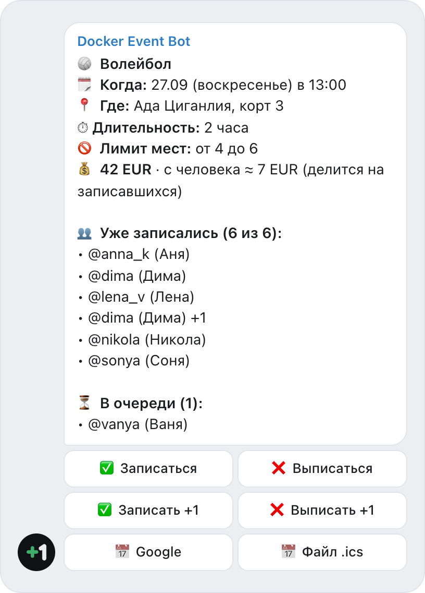
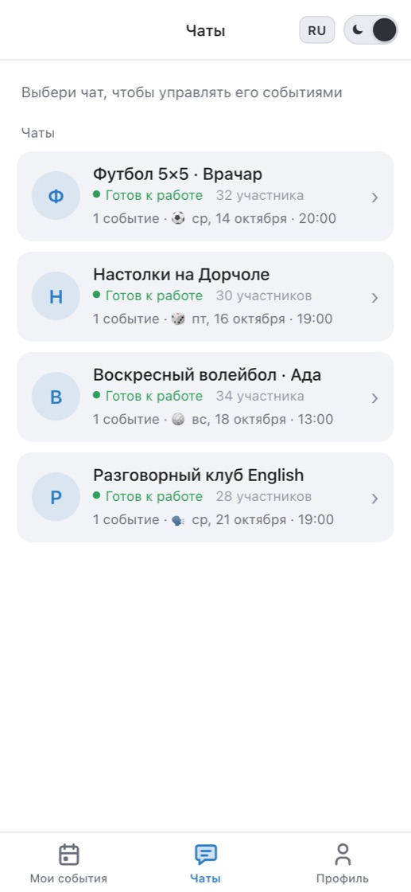
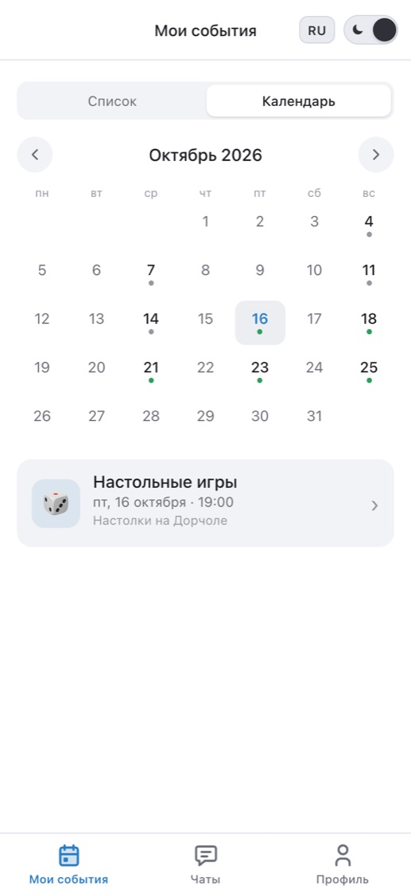
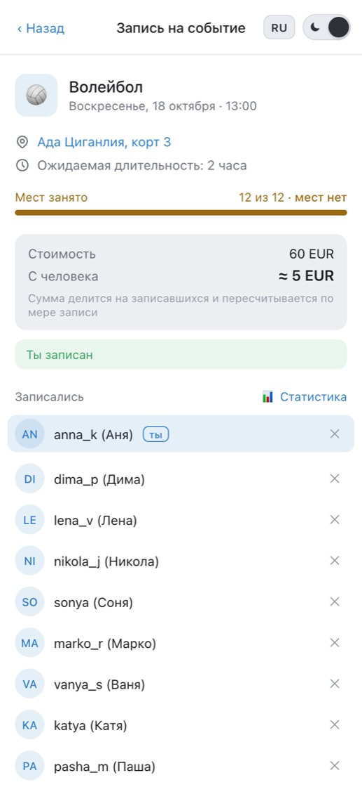
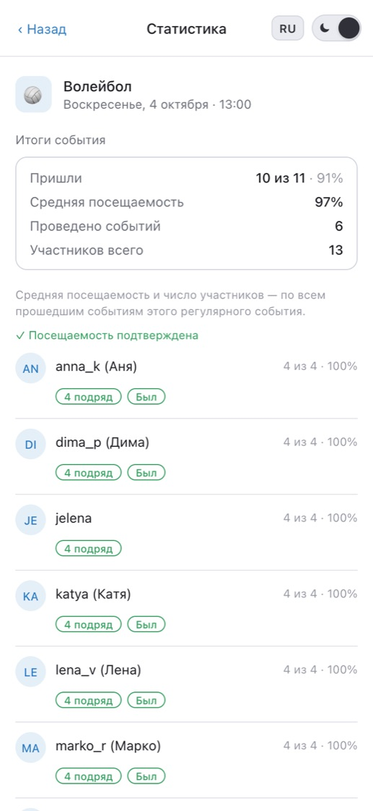

  

<h1 align="center">Docker Event Bot</h1>

  <b>Бесплатный бот для записи на события в группах Telegram.</b> 
  Карточка события с кнопкой «Записаться», лимит мест, очередь с автопродвижением, напоминания и регулярные события — прямо в том чате, где вы уже общаетесь.

  <a href="https://t.me/DockerEventBot?startgroup=true"><b>Добавить в группу</b></a> ·
  <a href="https://t.me/DockerEventBot">Открыть бота</a> ·
  <a href="https://dockerbot.app/ru/">Сайт</a> ·
  <a href="https://www.youtube.com/watch?v=hmaNflIHof0">Видео (1:23)</a>

  <a href="README.md">English</a> · <b>Русский</b> · <a href="README.sr.md">Srpski</a>

> **Это не Docker.** Docker Event Bot — Telegram-бот для записи на события в группах. С контейнерами Docker и компанией Docker, Inc. он не связан.

  <picture>
    <source media="(prefers-color-scheme: dark)" srcset="screenshots/card-ru-dark.png">
    
  </picture>

## Зачем

Приложения для событий проигрывают по одной причине: всем двенадцати надо их скачать, зарегистрироваться и во всём разобраться. Поэтому группы так и остаются с «+1 в комментариях» и опросами, которые не умеют считать места.

Docker Event Bot никого никуда не переселяет. Бот публикует карточку события в вашей группе, люди жмут **Записаться** — а список, свободные места и очередь обновляются в карточке сами. Участникам не нужно ничего, кроме Telegram: ни приложения, ни регистрации, ни форм.

## Возможности

- ⏳ **Очередь с автопродвижением** — мест нет, человек встаёт в очередь; кто-то выписался — следующий получает место и сообщение в личку.
- ⏰ **Напоминания** — до трёх (скажем, за день и за час) в личку, плюс кнопка «напомнить сейчас» у организатора. А организатору за сутки — сообщение, если до минимума не хватает людей.
- 🔁 **Регулярные события** — «каждую среду в 20:00»: бот сам публикует новую карточку по расписанию. Разовые события тоже есть.
- 👥 **Записать друга** — «Записать +1»: друг без Telegram тоже занимает место и учитывается в лимите.
- 📅 **Календарь** — добавить событие в Google Календарь или в календарь iPhone (.ics) прямо из карточки.
- ✅ **Явка и надёжность** — опрос «был(а)?» после события, отметки админа, статистика посещаемости и ачивки в каждом чате.
- 💰 **Сплит стоимости (по желанию)** — укажите аренду зала, карточка покажет долю с человека и пересчитает её по мере записи. Деньги через бота не идут.
- 🔔 **Отмена, перенос, правки** — все записавшиеся получат сообщение в личку: что было и что стало.
- 🏆 **Команды и турниры (по желанию)** — люди создают команду или вступают в неё, а в карточке — таблица составов с капитаном.
- 📍 **Ссылка на место** — карта или сайт зала в карточке, в напоминаниях и в календаре.
- 💬 **Все ваши чаты в одном месте** — приложение внутри Telegram показывает все группы с ботом, все ваши записи в одном календаре и единый пульт для организатора.
- 🌍 **Русский, английский и сербский.**

## Как это работает

1. **Добавьте [@DockerEventBot](https://t.me/DockerEventBot?startgroup=true) в группу** и сделайте админом — так он сможет публиковать и закреплять карточки.
2. **Создайте событие** в приложении — или напишите `/start` прямо в чате, и бот предложит форму. Разовое или еженедельное, с местом, временем и лимитом мест.
3. **Люди жмут «Записаться».** Список, свободные места и очередь обновляются прямо в карточке.

## Приложение внутри Telegram

<table>
  <tr>
    <td align="center" width="25%">
      <picture>
        <source media="(prefers-color-scheme: dark)" srcset="screenshots/chats-ru-dark.jpg">
        
      </picture>
       <b>Все чаты на одном экране</b>
    </td>
    <td align="center" width="25%">
      <picture>
        <source media="(prefers-color-scheme: dark)" srcset="screenshots/calendar-ru-dark.jpg">
        
      </picture>
       <b>Один календарь на все записи</b>
    </td>
    <td align="center" width="25%">
      <picture>
        <source media="(prefers-color-scheme: dark)" srcset="screenshots/event-ru-dark.jpg">
        
      </picture>
       <b>Страница события</b>
    </td>
    <td align="center" width="25%">
      <picture>
        <source media="(prefers-color-scheme: dark)" srcset="screenshots/stats-ru-dark.jpg">
        
      </picture>
       <b>Явка и надёжность</b>
    </td>
  </tr>
</table>

## Для чего подходит

⚽ Футбол · 🏐 Волейбол · 🎾 Теннис и падел · 🏀 Баскетбол · 🧘 Йога и тренировки · 🏃 Беговые клубы · 🎲 Настолки · 🗣 Языковые клубы · 📚 Книжные клубы · 🎤 Встречи и мастер-классы · 🥾 Походы · 🎉 Вечеринки и встречи

## Вопросы

**Нужно ли самому разворачивать или устанавливать бота?**
Нет. Docker Event Bot — готовый работающий бот: добавьте [@DockerEventBot](https://t.me/DockerEventBot) в группу и опубликуйте первое событие. Ни сервера, ни установки не нужно.

**Это бесплатно?**
Да. Подписки нет, платежей через бота нет. Необязательный сплит стоимости только считает долю каждого — деньгами вы рассчитываетесь между собой, как и раньше.

**Участникам нужно что-то устанавливать?**
Нет. Каждый записывается кнопкой на карточке в групповом чате. Mini App открывается внутри Telegram, когда нужно больше.

**Как сделать список записи в группе Telegram?**
Добавьте @DockerEventBot в группу и сделайте админом, затем создайте событие в приложении — или напишите `/start` прямо в чате. Бот опубликует карточку с кнопкой «Записаться», а список участников, свободные места и очередь будут обновляться в ней сами.

**Чем это лучше опроса в чате?**
Опрос в Telegram не умеет ограничивать число мест, вести очередь и напоминать. Карточка бота сама считает места и продвигает очередь, когда кто-то выписался, — в том же чате, а перед началом бот напомнит каждому в личку.

**Кто может создавать и менять события?**
Только админы чата. Каждое действие проверяется на сервере.

**Какие данные хранит бот?**
Только нужное для записи: Telegram ID, имя или @ник, язык и история записей. Команда `/privacy` в личке бота удаляет все ваши данные — самостоятельно и сразу. Подробнее: [политика конфиденциальности](https://dockerbot.app/ru/privacy/) · [пользовательское соглашение](https://dockerbot.app/ru/terms/).

## Бесплатный генератор команд

Нужно поделить записавшихся на команды? [Генератор команд](https://dockerbot.app/ru/team-generator/) делит случайно или поровну по уровню (1–5). Всё считается в браузере, список никуда не отправляется.

## Об этом репозитории

Это публичная страница Docker Event Bot: описание, скриншоты и место для вопросов и идей. Исходный код бота здесь не публикуется — и он не нужен: бот уже работает, просто добавьте [@DockerEventBot](https://t.me/DockerEventBot) в группу.

Нашли ошибку или есть идея? [Создайте issue](../../issues) или напишите на **dockereventbot@gmail.com**. Оценить бота можно и прямо в приложении, на вкладке «Профиль».
