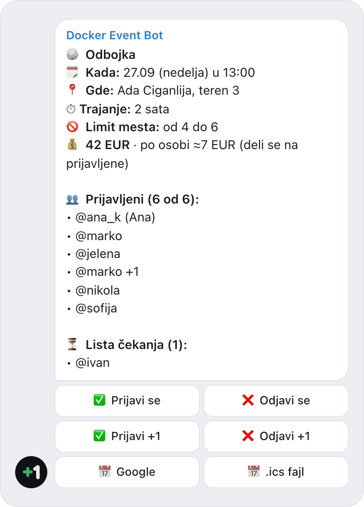
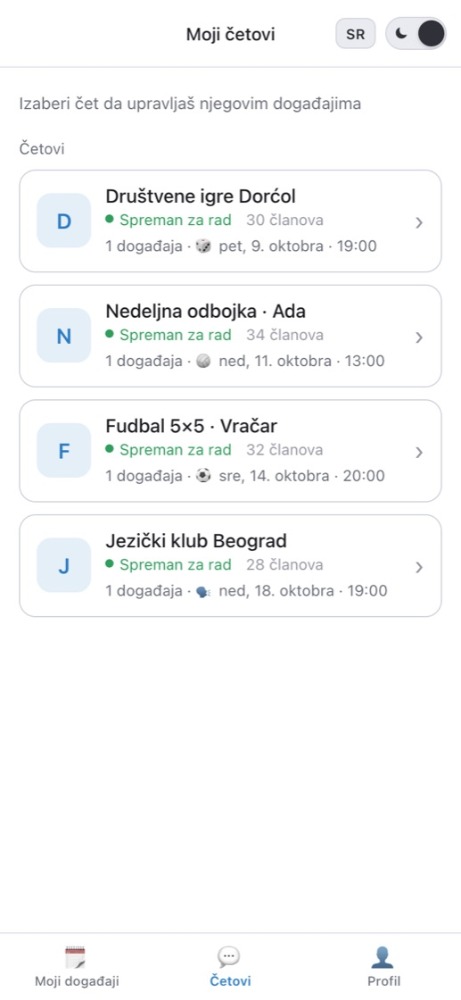
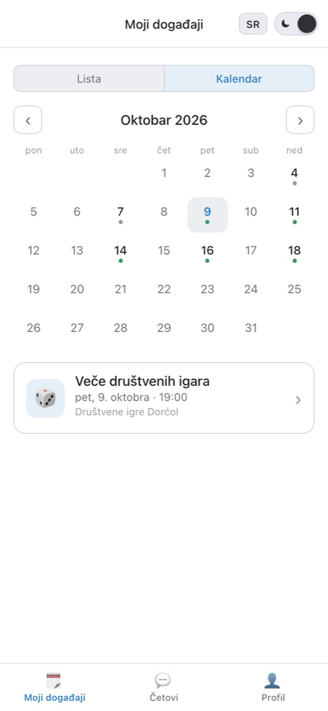
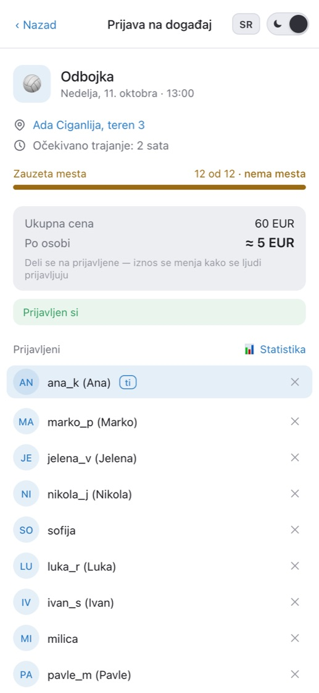
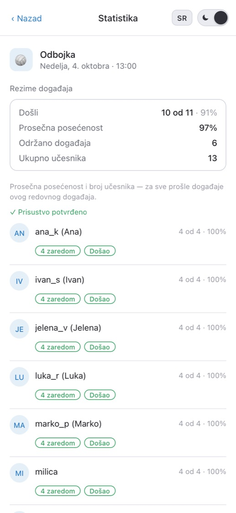

  

<h1 align="center">Docker Event Bot</h1>

  <b>Besplatan Telegram bot za prijave na događaje u grupama.</b> 
  Kartica događaja sa dugmetom „Prijavi se”, limit mesta, lista čekanja sa automatskim pomeranjem, podsetnici i redovni događaji — direktno u četu u kom se već dopisujete.

  <a href="https://t.me/DockerEventBot?startgroup=true"><b>Dodaj u grupu</b></a> ·
  <a href="https://t.me/DockerEventBot">Otvori bota</a> ·
  <a href="https://dockerbot.app/sr/">Sajt</a> ·
  <a href="https://www.youtube.com/watch?v=rxUWXiZB93M">Video (1:21)</a>

  <a href="README.md">English</a> · <a href="README.ru.md">Русский</a> · <b>Srpski</b>

> **Ovo nije Docker.** Docker Event Bot je Telegram bot za prijave na grupne događaje. Nije povezan sa Docker kontejnerima niti kompanijom Docker, Inc.

  <picture>
    <source media="(prefers-color-scheme: dark)" srcset="screenshots/card-sr-dark.png">
    
  </picture>

## Zašto

Aplikacije za događaje padaju iz jednog razloga: svih dvanaest ljudi mora da ih skine, registruje se i savlada ih. Zato grupe ostaju na „+1 u komentarima” i anketama koje ne umeju da broje mesta.

Docker Event Bot ne traži od nikoga da se seli. Bot objavi karticu događaja u vašoj grupi, ljudi pritisnu **Prijavi se**, a spisak, slobodna mesta i lista čekanja se sami osvežavaju u kartici. Učesnicima ne treba ništa osim Telegrama — ni aplikacija, ni nalog, ni formulari.

## Mogućnosti

- ⏳ **Lista čekanja sa automatskim pomeranjem** — nema mesta, čovek staje na listu čekanja; neko se odjavi — sledeći dobija mesto i privatnu poruku.
- ⏰ **Podsetnici** — N sati pre početka, u četu i u privatnoj poruci. A organizatoru dan ranije — poruka ako do minimuma nedostaje ljudi.
- 🔁 **Redovni događaji** — „svake srede u 20:00”: bot sam objavljuje novu karticu po rasporedu. Postoje i jednokratni događaji.
- 👥 **Prijavi prijatelja** — „Prijavi +1”: prijatelj bez Telegrama takođe zauzima mesto i računa se u limit.
- 📅 **Kalendar** — dodajte događaj u Google Calendar ili iPhone kalendar (.ics) direktno iz kartice.
- ✅ **Dolasci i pouzdanost** — anketa „Da li si bio/la?” posle događaja, oznake admina, statistika dolazaka i dostignuća za svaki čet.
- 💰 **Podela troškova (po želji)** — unesite cenu terena, kartica pokazuje deo po osobi i preračunava ga kako se ljudi prijavljuju. Novac ne ide preko bota.
- 🔔 **Otkazivanje, pomeranje, izmene** — svi prijavljeni dobijaju privatnu poruku: šta je bilo i šta je sada.
- 🏆 **Timovi i turniri (po želji)** — ljudi prave tim ili mu se pridružuju, a u kartici je tabela sastava sa kapitenom.
- 📍 **Link do mesta** — mapa ili sajt terena u kartici, podsetnicima i kalendaru.
- 💬 **Svi vaši četovi na jednom mestu** — aplikacija unutar Telegrama prikazuje sve grupe sa botom, sve vaše prijave u jednom kalendaru i jednu kontrolnu tablu za organizatore.
- 🌍 **Srpski, engleski i ruski.**

## Kako radi

1. **Dodajte [@DockerEventBot](https://t.me/DockerEventBot?startgroup=true) u grupu** i postavite ga za admina — tako može da objavljuje i kači kartice.
2. **Napravite događaj** u aplikaciji — ili pošaljite `/start` u četu i bot će ponuditi formu. Jednokratni ili nedeljni, sa mestom, vremenom i limitom mesta.
3. **Ljudi pritisnu „Prijavi se”.** Spisak, slobodna mesta i lista čekanja osvežavaju se direktno u kartici.

## Aplikacija unutar Telegrama

<table>
  <tr>
    <td align="center" width="25%">
      <picture>
        <source media="(prefers-color-scheme: dark)" srcset="screenshots/chats-sr-dark.jpg">
        
      </picture>
       <b>Svi četovi na jednom ekranu</b>
    </td>
    <td align="center" width="25%">
      <picture>
        <source media="(prefers-color-scheme: dark)" srcset="screenshots/calendar-sr-dark.jpg">
        
      </picture>
       <b>Jedan kalendar za sve prijave</b>
    </td>
    <td align="center" width="25%">
      <picture>
        <source media="(prefers-color-scheme: dark)" srcset="screenshots/event-sr-dark.jpg">
        
      </picture>
       <b>Stranica događaja</b>
    </td>
    <td align="center" width="25%">
      <picture>
        <source media="(prefers-color-scheme: dark)" srcset="screenshots/stats-sr-dark.jpg">
        
      </picture>
       <b>Dolasci i pouzdanost</b>
    </td>
  </tr>
</table>

## Za šta je dobar

⚽ Fudbal · 🏐 Odbojka · 🎾 Tenis i padel · 🏀 Košarka · 🧘 Joga i treninzi · 🏃 Trkački klubovi · 🎲 Društvene igre · 🗣 Jezički klubovi · 📚 Klubovi čitalaca · 🎤 Okupljanja i radionice · 🥾 Planinarenje · 🎉 Žurke i druženja

## Pitanja

**Da li je besplatno?**
Da. Nema pretplate i nema plaćanja preko bota. Opciona podela troškova samo računa deo svakoga — novac poravnavate između sebe, kao i do sada.

**Da li učesnici moraju nešto da instaliraju?**
Ne. Svako se prijavljuje dugmetom na kartici u grupnom četu. Mini App se otvara unutar Telegrama kad vam treba više.

**Kako da napravim spisak prijava u Telegram grupi?**
Dodajte @DockerEventBot u grupu i postavite ga za admina, pa napravite događaj u aplikaciji — ili pošaljite `/start` u četu. Bot objavljuje karticu sa dugmetom „Prijavi se”, a spisak učesnika, slobodna mesta i lista čekanja se u njoj sami osvežavaju.

**Po čemu je ovo bolje od ankete u četu?**
Telegram anketa ne može da ograniči broj mesta, vodi listu čekanja niti da podseća. Kartica bota sama broji mesta, pomera listu čekanja kad se neko odjavi i šalje podsetnike — u istom četu.

**Ko može da pravi i menja događaje?**
Samo admini četa. Svaka radnja se proverava na serveru.

**Koje podatke bot čuva?**
Samo ono što je potrebno za prijave: Telegram ID, ime ili @nadimak, jezik i istoriju prijava. Komanda `/privacy` u privatnom četu sa botom briše sve vaše podatke — sami i odmah. Detaljnije: [politika privatnosti](https://dockerbot.app/sr/privacy/) · [uslovi korišćenja](https://dockerbot.app/sr/terms/).

## Besplatan generator timova

Treba da podelite prijavljene u timove? [Generator timova](https://dockerbot.app/sr/team-generator/) deli nasumično ili ravnomerno po nivou (1–5). Sve se računa u pregledaču, spisak se nigde ne šalje.

## O ovom repozitorijumu

Ovo je javna stranica Docker Event Bot-a: opis, snimci ekrana i mesto za pitanja i ideje. Izvorni kod bota ovde nije objavljen.

Našli ste grešku ili imate ideju? [Otvorite issue](../../issues) ili pišite na **dockereventbot@gmail.com**. Bota možete oceniti i direktno u aplikaciji, na kartici „Profil”.
